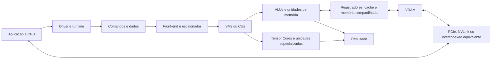

# 8. Integração, Limitações e Desempenho

## 8.1 Integração dos Componentes
Uma GPU funciona como um sistema integrado de processamento paralelo. A CPU e o driver preparam os comandos e os dados. O front-end da GPU recebe os kernels e os blocos de threads. Os escalonadores distribuem esses blocos entre SMs ou CUs, que executam as operações nas ALUs, unidades de carregamento e armazenamento, Tensor Cores e outras unidades especializadas.

Durante a execução, os dados percorrem a hierarquia de memória: registradores, memória compartilhada, caches e VRAM. A interconexão PCIe ou outra interface equivalente liga a GPU à CPU e aos dispositivos externos. Os resultados podem alimentar outro kernel, retornar à CPU, ser exibidos na tela ou ser entregues a uma aplicação de IA.

## 8.2 Características que Favorecem o Funcionamento
- **Paralelismo em larga escala:** muitas threads executam a mesma operação sobre dados diferentes.
- **Hierarquia de memória:** registradores, memória compartilhada e caches reduzem acessos à VRAM.
- **Alta largura de banda:** a VRAM movimenta grandes volumes de dados necessários para gráficos e IA.
- **Execução heterogênea:** a CPU trata o controle geral e a GPU acelera as partes com alto paralelismo.
- **Unidades especializadas:** Tensor Cores, unidades de vídeo e ray tracing atendem tarefas específicas com mais eficiência.
- **Escalonamento de threads:** quando um grupo espera a memória, outro pode ocupar a unidade de execução.
- **Software de programação:** CUDA, HIP e OpenCL permitem adaptar a GPU a gráficos, ciência, vídeo e inteligência artificial.

## 8.3 Decisões Arquiteturais Importantes
A principal decisão foi trocar poucos núcleos complexos por muitas unidades menores e paralelas. Essa escolha atende bem ao processamento de pixels, vértices, matrizes e tensores, que podem ser divididos em muitos trabalhos semelhantes.

Outra decisão foi organizar as threads em warps ou wavefronts. O grupo executa uma instrução comum, reduzindo o custo de controle, mas exigindo que o algoritmo evite muitos caminhos diferentes dentro do mesmo grupo.

A GPU também prioriza largura de banda e quantidade de operações por segundo. Em contrapartida, aceita maior complexidade para programar acessos à memória, sincronização e dependências entre tarefas.

## 8.4 Fatores que Influenciam o Desempenho
O desempenho não depende apenas da quantidade de núcleos ou da frequência do clock. Os principais fatores são:

- quantidade de trabalho independente disponível;
- ocupação dos SMs ou CUs;
- largura de banda e latência da VRAM;
- reutilização de dados em caches e memória compartilhada;
- acesso coalescido e organizado à memória;
- quantidade de registradores usada por thread;
- divergência de caminhos dentro de warps ou wavefronts;
- frequência e custo de sincronizações;
- transferências entre CPU, RAM e GPU;
- uso adequado de unidades especializadas e formatos numéricos.

Uma tarefa com muito cálculo independente tende a ser limitada pela capacidade de processamento. Uma tarefa que movimenta muitos dados pode ser limitada pela memória. Já uma tarefa pequena ou sequencial pode ser limitada pelo custo de iniciar o kernel e transferir os dados.

## 8.5 Capacidade de Processamento e Comunicação
A GPU pode executar milhares de threads simultaneamente e alcançar alto desempenho em operações vetoriais, matriciais e gráficas. Esse potencial só é aproveitado quando os dados chegam às unidades de execução com rapidez suficiente.

A comunicação entre CPU e GPU ocorre normalmente por PCIe, enquanto sistemas específicos podem usar NVLink ou outra interconexão de maior largura de banda. A comunicação interna entre SMs/CUs e a VRAM também é decisiva. Se a aplicação copia dados repetidamente ou acessa a memória de forma irregular, as unidades de cálculo podem ficar esperando.

## 8.6 Armazenamento e Paralelismo
Arquivos e modelos são mantidos em SSD ou HD, carregados para a RAM e então transferidos para a VRAM. Durante o processamento, os dados intermediários ficam em registradores, memória compartilhada, caches e VRAM. Manter os dados na GPU entre kernels reduz transferências e melhora o desempenho.

O paralelismo é mais eficiente quando os blocos são independentes. Dependências entre blocos, barreiras frequentes e necessidade de executar etapas em ordem reduzem a quantidade de trabalho simultâneo. Por isso, o programa precisa dividir o problema sem criar esperas desnecessárias.

## 8.7 Principais Vantagens
- excelente desempenho em gráficos, simulações, processamento de imagens e IA;
- grande quantidade de operações paralelas;
- alta largura de banda de memória;
- unidades especializadas para operações comuns em aplicações modernas;
- possibilidade de manter CPU e GPU trabalhando simultaneamente;
- flexibilidade para diferentes domínios por meio de APIs de computação.

## 8.8 Principais Limitações e Gargalos
- desempenho reduzido em tarefas sequenciais ou com muitas dependências;
- divergência de threads dentro do mesmo warp ou wavefront;
- capacidade limitada da VRAM para modelos e conjuntos de dados grandes;
- latência e largura de banda do PCIe podem limitar a comunicação com a CPU;
- acessos irregulares reduzem o aproveitamento de caches e da VRAM;
- sincronização frequente deixa unidades de execução ociosas;
- programação e otimização mais complexas que em um fluxo puramente sequencial;
- consumo de energia e dissipação térmica aumentam em cargas intensivas.

## 8.9 Questão Central
**A característica que mais influencia a capacidade da GPU é o paralelismo organizado em larga escala, apoiado por uma hierarquia de memória de alta largura de banda.**

Essa combinação permite aplicar uma mesma operação a milhares de elementos ao mesmo tempo, que é exatamente o tipo de trabalho encontrado em gráficos, multiplicação de matrizes, convoluções e simulações. O paralelismo sozinho não é suficiente: se os dados não chegarem rapidamente ou se as threads divergirem demais, as unidades ficam ociosas. Por isso, a capacidade real da GPU resulta da combinação entre unidades paralelas, acesso eficiente à memória e comunicação adequada com a CPU.

## 8.10 Adequação ao Objetivo
A arquitetura de GPU é adequada quando o problema possui grande volume de dados e operações semelhantes. Ela foi criada para acelerar a renderização gráfica e evoluiu para atender computação científica e IA.

Ela não substitui completamente a CPU. A CPU continua mais adequada para controle geral, decisões sequenciais, gerenciamento do sistema e tarefas com pouca quantidade de paralelismo. A melhor solução é o uso conjunto: CPU para coordenar e GPU para acelerar as partes paralelizáveis.

## Comparação Resumida

| Aspecto | GPU | Impacto |
|---|---|---|
| Processamento | Muitos SMs/CUs e unidades especializadas | Alto paralelismo em tarefas adequadas |
| Memória | Registradores, caches, memória compartilhada e VRAM | Equilíbrio entre velocidade, capacidade e largura de banda |
| Comunicação | PCIe, NVLink e barramento de memória | Pode acelerar ou limitar o sistema |
| Controle | CPU, driver, runtime e escalonadores | Coordena kernels e grupos de threads |
| Principal vantagem | Executar muitas operações semelhantes simultaneamente | Excelente para gráficos, matrizes e IA |
| Principal limitação | Dependência de paralelismo e acesso eficiente aos dados | Tarefas sequenciais podem ter pouco ganho |
